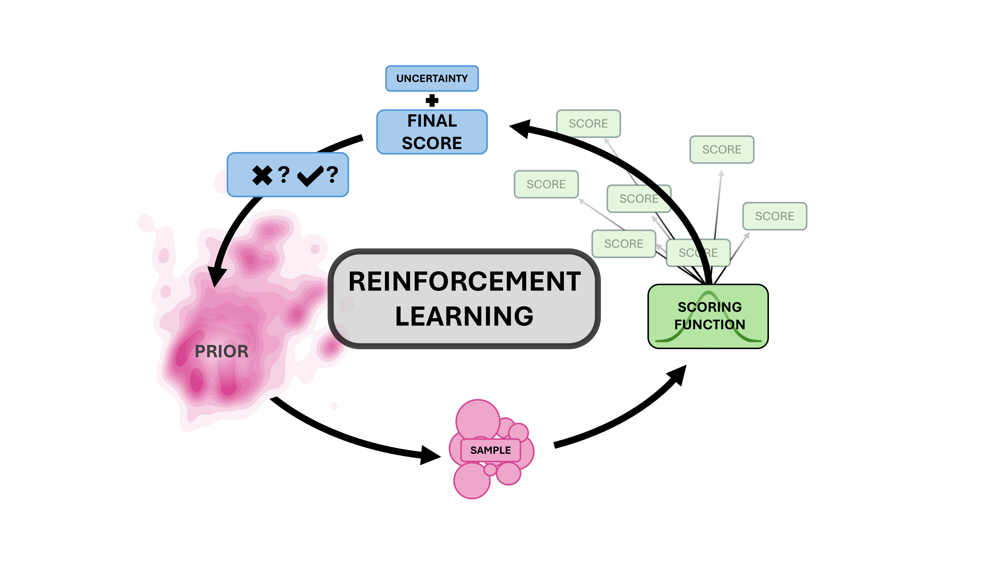

# Uncertainty-Aware reinforcement learning for chemical language models

This repository contains the code and experiments for the article on uncertainty-aware reinforcement learning for de novo molecular design.
Everything corresponding to the paper is inside of `UncertaintyAwareRLforCLM`




DISCLAIMER: If you want to check the `README.md` of REINVENT4 check `REINVENT4_README.md` 


## REINVENT4 Introduction and Credit

REINVENT4 is an open-source framework for molecular generation and multi-objective optimization. It uses a generative model (policy) to propose molecules and optimizes it with reinforcement learning based on scoring functions.

In this article, REINVENT4 is the baseline framework and has been extended with new uncertainty-aware functionalities. These additions are implemented on top of the REINVENT4 workflow while preserving its core training and optimization process.

This work relies on the original REINVENT4 implementation and the contributions of its authors and maintainers. Please cite also the official REINVENT4 publication and repository when using or referencing this project.


## Repository Structure

- `00_data/`: dataset preparation and cleaning.
- `01_cp/`: conformal prediction and random forest uncertainty modeling.
- `01_chemprop/`: Chemprop MVE training scripts.
- `02_RL/`: REINVENT4 reinforcement learning experiments and configs.
- `03_results/`: generated figures and summary plots.
- `figures.ipynb`: notebook used for article plots.

## Environment Setup

Use **two separate environments** for the Chemprop experiments:

- `reinvent4`: runs REINVENT and its scoring components. The package declares a legacy Chemprop 1.x dependency; keep that dependency in this environment.
- `chemprop`: runs Chemprop 2.2.1 training and the external MVE prediction scripts with Python 3.11.

Do not install Chemprop 2 into the REINVENT environment. The Chemprop experiment configs use `ExternalProcess` to launch a separate Python process, so the two Chemprop versions do not need to coexist in one interpreter. Model-system experiments do not need the external Chemprop 2 environment.

Run the following installation commands from the **repository root** (the directory containing this README and `pyproject.toml`):

```bash
conda create -n chemprop python=3.11 pip
conda run -n chemprop python -m pip install "chemprop==2.2.1"

conda create -n reinvent4 python=3.10 pip
conda activate reinvent4
python -m pip install -e .
```

The editable install uses this repository's modified REINVENT implementation. See [REINVENT4 installation instructions](REINVENT4_README.md) for hardware requirements and optional dependencies. Install notebook and analysis dependencies separately as needed. These commands provide a minimal setup rather than a fully pinned reproduction environment.

### Existing Environment Exports

The supplied YAML files are located at `UncertaintyAwareRLforCLM/00_data/chemprop.yaml` and `UncertaintyAwareRLforCLM/00_data/reinvent4.yaml`, not in the repository root. For example, to use the original Chemprop export instead of the minimal setup above:

```bash
conda env create -f UncertaintyAwareRLforCLM/00_data/chemprop.yaml
```

These files record the original environments and include platform-specific packages and build versions. They may require adjustments for your system and package sources. For a new installation, prefer the minimal setup above. OpenEye is optional and requires its own package source and license when used.

### Connect REINVENT to Chemprop 2

In **each** Chemprop `ExternalProcess` endpoint, replace the original `/home/$USER$/...` executable and machine-specific paths. Either call the Chemprop environment's Python directly:

```json
{
    "executable": "/absolute/path/to/envs/chemprop/bin/python",
    "args": "/absolute/path/to/repo/reinvent_plugins/components/model_scoring_components/chemprop2_extProccessG.py /absolute/path/to/model_directory",
    "property": "predictions",
    "uncertainty_type": "gaussianSample"
}
```

Or set `executable` to the absolute path of your conda executable and prefix `args` with `run --no-capture-output -n chemprop python `. Keep the endpoint's original script, property and uncertainty settings: uncertainty endpoints use `unc_chemprop2_extProccessG.py`. Quote individual paths within `args` if they contain spaces.

REINVENT appends a temporary SMILES-file path to these arguments and reads JSON predictions/uncertainties from stdout. The model directory must contain the trained checkpoints and `*calibrator.pkl` expected by the wrapper. Activate `reinvent4` to run RL; there is no need to activate `chemprop` in the same shell. Other paths in the RL config must also match your installation and working directory.

## How to Reproduce the Workflow

Run the pipeline in this order.

### 1) Data Preparation

Start from:

- `00_data/cleaningData.ipynb`

The datasets were downloaded form ChEMBL Version 34.

This step produces curated datasets under `00_data/egfr/` and `00_data/drd2/` used by downstream models.

Create the environments using the instructions above before running the notebook. Its environment-creation commands are commented out and do not install anything as supplied.

### 2) Train Uncertainty Models

#### 2.1 Chemprop MVE models

GPU cluster (SLURM) examples:

```bash
sbatch 01_chemprop/runChempropSuperSmall.sh
sbatch 01_chemprop/runChempropFull.sh
```

These scripts train MVE Chemprop regressors and save artifacts to the paths defined inside each script.

#### 2.2 Conformal prediction (RF + split conformal)

Script:

- `01_cp/conformerPredictionModel.ipynb`

Inside this notebook we create the conformal prediction model


### 3) Run REINVENT4 RL Experiments


- `02_RL/`

This folder contains all required configuration files, organized by experiment type, including Model System experiments, Chemprop experiments (point-estimation and averaged variants), and conformal prediction experiments.

For the Model System, configurations are provided for both the Unique Noisy Function and Multiple Noisy Functions settings, as well as the low-similarity and mid-similarity scenarios used in the article.

Main launcher scripts:

- `02_RL/runRL.sh` (GPU partition)
- `02_RL/runRLcpu.sh` (CPU partition)
- `02_RL/runMultiple.sh` (batch submit for a config folder)

Submit one RL run:

```bash
sbatch 02_RL/runRL.sh 02_RL/finalRL/multipleNoise_low/rl_doubleUnc_w0_SF_w1_N5.json
```

Submit multiple runs:

```bash
bash 02_RL/runMultiple.sh
```

Run locally without SLURM:

```bash
conda activate reinvent4
reinvent --log-level debug 02_RL/finalRL/multipleNoise_low/rl_doubleUnc_w0_SF_w1_N5.json
```

### 4) Collect and Plot Results

Main output locations:

- RL logs: `02_RL/00_reinventLogs/`
- RL experiment folders: `02_RL/finalRL/`
- figures used in the article: `03_results/`

For final figure generation and presentation plots, use:

- `figures.ipynb`

## Quick Reproduction Checklist

1. Install this repository in `reinvent4`; for Chemprop experiments, also create the separate Chemprop 2 environment and update every external scorer's executable/script/model paths as described above.
2. Prepare/clean datasets in `00_data/cleaningData.ipynb`.
3. Train Chemprop and/or conformal uncertainty models.
4. Select RL JSON configs in `02_RL/finalRL/.../csv/`.
5. Launch RL with `sbatch 02_RL/runRL.sh <config.json>`.
6. Aggregate and visualize results from `03_results/` and `figures.ipynb`.

## Paper Context

The article studies how predictive uncertainty can be integrated into molecular RL in two ways:

1. As an explicit optimization objective in the scoring function.
2. As a modulation signal for policy updates.

Experiments include synthetic and real-world uncertainty settings (AD-like scenarios, Chemprop MVE, and conformal prediction), implemented in the REINVENT4 optimization pipeline.


## REINVENT4
### 1) Main changes in REINVENT4

We implemented new uncertainty-aware scoring components in REINVENT4.

Main plugin folder:

`reinvent_plugins/components/model_scoring_components`

All scripts in this folder are additions used to incorporate uncertainty into scoring.

#### 1.1 Core uncertainty components

- `comp_model_logp.py` (`NoisyLogP`): computes LogP and injects distance-dependent stochastic noise. The uncertainty scale increases with distance to training data.
- `comp_model_BertzCT.py` (`NoisyBertz`): same idea as `NoisyLogP`, but applied to BertzCT complexity.
- `comp_distances.py` (`UNCdistances`): computes distance-to-training (k-NN based) and returns a distance-derived weight to penalize out-of-domain molecules.

These components support tanimoto- and PCA-based distance variants through the shared helper functions in `compute_sims.py`.

#### 1.2 Chemprop uncertainty integration

- `comp_chemprop2.py` (`chemprop2`): Chemprop-based scoring component with MVE uncertainty estimation and calibration support.
- `chemprop2_extProccess.py`: external prediction script that outputs Chemprop predictions + calibrated uncertainties as JSON.
- `unc_chemprop2_extProccess.py`: external Chemprop script variant used for uncertainty-focused outputs.
- `chemprop2_extProccessG.py`: generalized external Chemprop inference script that loads checkpoints from a model folder and returns calibrated prediction/uncertainty JSON.
- `unc_chemprop2_extProccessG.py`: generalized uncertainty-focused variant that transforms uncertainty into a distance-like score.

#### 1.3 Classification conformal prediction components

- `comp_class_CP.py` (`classificationCP`): returns the active-class conformal p-value as a score.
- `comp_unc_class_CP.py` (`uncclassificationCP`): returns uncertainty-oriented weights from conformal prediction set confidence.


These components load a pre-trained conformal model artifact (`cloudpickle`) and compute conformal outputs from SMILES fingerprints.

#### 1.4 Shared utilities and examples

- `compute_sims.py`: shared similarity/distance utilities (Tanimoto, cosine, Euclidean in PCA space, optional distance transformation).


#### 1.5 Small modifcations of the whole REINVENT4 repo
- Adding the Average option - probabilistic scoring functions -  `reinvent/runmodes/RL/learning.py` line 136 and everything around average
- Adding the Loss Modulation inside REINVENT4:
    - `reinvent/runmodes/RL/reward.py`: LM (called reward in the config file)
    - `reinvent/runmodes/RL/reinvent`: weight retrieving and merging of the different scoring components
    - `reinvent/runmodes/RL/run_staged_learning.py`: sampling at the beginnign when necessary associated with each scoring component
    - `reinvent/runmodes/RL/learning.py`: minor modifications


#### 1.6 Notes

- The components above were used in the uncertainty experiments described in the article (model system, Chemprop, and conformal settings).
- Additional modifications were also made in other REINVENT4 files outside this folder to make the uncertainty work.

## Citation

This work is currently submitted as a preprint on arXiv. If you use this code or build on this work, please cite:


Please also cite the original REINVENT4 paper.


